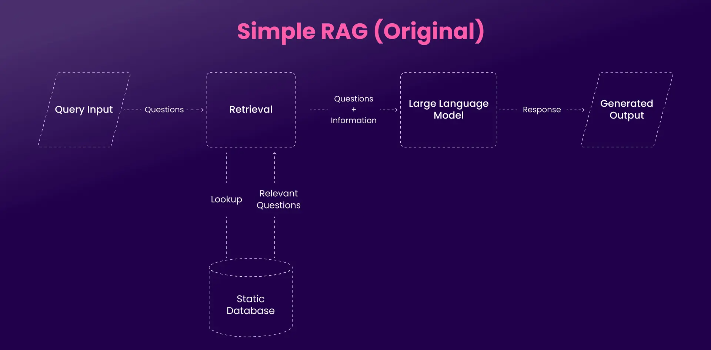

## Traditional RAG

Retrieval-Augmented Generation (RAG) is a technique for improving the output of a large language model (LLM) by grounding it in an external knowledge base. Instead of relying only on what the model learned during training, a RAG system retrieves relevant documents at query time and passes them to the LLM as context before it generates a response.

**Why it matters**

- **Fresher knowledge**: updating the knowledge base does not require retraining or fine-tuning the model.
- **Fewer hallucinations**: answers are grounded in retrieved evidence and can cite sources.
- **Private/domain data**: the model can answer over proprietary documents it never saw in training.
- **Lower cost**: usually cheaper and faster to iterate on than fine-tuning for knowledge injection.

## Main Components of RAG

1. **Ingestion (indexing pipeline)**
   - _Load/parse_: extract text from PDFs, HTML, docs, databases, etc.
   - _Chunk_: split content into retrievable units (fixed-size, recursive, semantic, or structure-aware chunking), usually with some overlap.
   - _Embed_: convert each chunk into a dense vector using an embedding model.
   - _Index_: store vectors and metadata in a vector store (e.g., FAISS, Qdrant, Milvus, Weaviate, pgvector, Pinecone), optionally alongside a keyword (BM25) index.
2. **Retrieval**
   - Embed the user query with the same model, then run similarity search (cosine / dot product) to get top-k chunks.
   - Common improvements: hybrid search (dense + BM25), metadata filtering, query rewriting/expansion, and reranking with a cross-encoder.
3. **Generation or Synthesis**
   - The retrieved chunks are inserted into the prompt together with the question.
   - The LLM synthesizes a grounded answer, ideally with citations to the source chunks.

## Architecture of RAG

## Limitations of Traditional RAG

- **Text-only view of the world**: standard pipelines index only text. Charts, diagrams, tables-as-images, screenshots, slides, audio, and video are dropped or poorly handled by OCR.
- **Data silos**: traditional RAG often struggles to integrate data across many sources and formats, leading to fragmented knowledge bases and inconsistent retrieval.
- **Lossy parsing and chunking**: PDF-to-text conversion destroys layout, table structure, and figure-caption relationships. Fixed-size chunking can split related information.
- **Retrieval quality ceiling**: if the right chunk is not in the top-k, the LLM cannot recover. Pure dense retrieval struggles with exact terms, IDs, and numbers.
- **Weak multi-hop reasoning**: questions requiring evidence from several documents or steps are hard for single-shot retrieval.
- **Context limits and noise**: too many or irrelevant chunks dilute the prompt ("lost in the middle" effect) and increase cost and latency.
- **Evaluation difficulty**: retrieval and generation fail independently, so they must be measured separately.

## Multi-modal RAG

Multimodal RAG extends RAG so the system can **ingest, retrieve, and reason over multiple modalities** such as text, images, audio, and video, rather than text alone. Queries can be multimodal too (e.g., a user uploads a photo and asks a text question), and the retrieved context can include images or video frames alongside text.

**What changes versus text-only RAG**

| Stage          | Text RAG          | Multimodal RAG                                                          |
| -------------- | ----------------- | ----------------------------------------------------------------------- |
| Ingestion      | Parse text, chunk | Parse text, images, tables, audio (ASR), video (frames and transcripts) |
| Representation | Text embeddings   | Multimodal embeddings, or text derived from each modality               |
| Retrieval      | Text to text      | Text to image, image to text, cross-modal, or any-to-any                |
| Generation     | LLM               | Vision-language model (VLM) or multimodal LLM                           |

## Multimodal Embeddings and Generation

### Multimodal embeddings

The core idea is to map different modalities into a **shared vector space**, so a text query and an image of the same concept land close together.

- **CLIP / SigLIP**: dual-encoder models trained contrastively on image-text pairs. Good for image search and zero-shot matching, but weaker on dense text-heavy documents.
- **ImageBind**: aligns several modalities (image, text, audio, depth, thermal, IMU) into one space using image as the anchor.
- **CLAP**: contrastive audio-text embeddings for audio retrieval.
- **Late-interaction document retrievers (ColPali / ColQwen family)**: embed page images directly with a VLM and use ColBERT-style multi-vector matching, avoiding OCR and layout parsing for visually rich documents.
- **Commercial/open multimodal embedding APIs and models**: for example Cohere Embed, Voyage multimodal, Jina CLIP/v4, and Nomic Embed Vision. Check current benchmarks (e.g., ViDoRe for document retrieval, MTEB-style multimodal leaderboards) before choosing.

**Practical considerations**

- Use the same embedding model for indexing and querying.
- Store metadata (source, page, timestamp, modality) with every vector for filtering and citations.
- Single-vector indexes are cheap; multi-vector (late interaction) indexes give better accuracy but cost much more storage and compute.

### Multimodal generation

Once relevant context is retrieved, a **vision-language model or multimodal LLM** produces the answer.

- **Proprietary**: Claude, GPT-4o family, Gemini (also handles long video/audio natively).
- **Open-weight**: Qwen-VL family, LLaVA, InternVL, Llama vision models, Pixtral, PaliGemma.
- Inputs: the question, retrieved text, and retrieved images/frames (as image tokens), plus audio transcripts when applicable.
- Outputs are usually text; some systems also generate images or speech.
- Watch token cost: images and video frames consume many tokens, so limit the number and resolution of retrieved images.

## Different Approaches to Build Multimodal RAG

### 1. Unified multimodal embedding space (embed everything together)

All modalities are embedded with a single model (e.g., CLIP-style) into one vector store. A query retrieves text and images directly, and the raw multimodal results go to a multimodal LLM.

- ✅ Simple architecture; true cross-modal retrieval.
- ❌ Embedding quality on fine-grained or text-dense content can be limited; the generator must be multimodal.

### 2. Ground everything to text (modality-to-text)

Convert each modality into text first: image captions/VLM descriptions, OCR and table extraction, speech-to-text (e.g., Whisper) for audio and video, and frame descriptions. Then run a standard text RAG pipeline.

- ✅ Reuses mature text RAG tooling; works with any text-only LLM; easy to debug and search.
- ❌ Lossy: captions miss details; ingestion cost is high (a VLM call per image/frame); quality depends on the captioning step.

### 3. Hybrid / separate stores with multimodal reranking

Keep separate indexes per modality (e.g., text vectors, image vectors), retrieve from each, then merge and rerank. Often images are stored with a text summary used for retrieval, while the **raw image is passed to the generator** (the "multi-vector retriever" pattern).

- ✅ Best of both: precise retrieval via text summaries, full fidelity at generation time.
- ❌ More moving parts; requires score fusion and careful metadata linking between summaries and originals.

### 4. Visual document retrieval (page-as-image)

Render each document page as an image and embed it directly with a late-interaction VLM retriever (ColPali-style). Retrieve the best pages and give them to a VLM.

- ✅ Skips OCR/layout parsing; excellent for slides, infographics, charts, and scanned documents.
- ❌ Heavier index and compute; VLM context cost per page.

### 5. Agentic / multi-step multimodal RAG

An LLM agent plans, chooses tools (text search, image search, video segment lookup, table query, code execution), iterates, and verifies. Useful for multi-hop, multi-document, and multi-modality questions.

- ✅ Handles complex queries and mixed sources.
- ❌ Higher latency and cost; harder to evaluate and make deterministic.

### Choosing an approach

| Need                                   | Suggested approach                   |
| -------------------------------------- | ------------------------------------ |
| Fast MVP, mostly text with some images | Ground to text (2)                   |
| Image search / photo-centric data      | Unified embeddings (1)               |
| Slide decks, scanned PDFs, charts      | Visual document retrieval (4)        |
| Mixed corpus, high accuracy needs      | Hybrid with multimodal reranking (3) |
| Complex multi-hop questions            | Agentic (5), built on top of 1-4     |

## Evaluation

Evaluate retrieval and generation separately.

- **Retrieval**: Recall@k, MRR, nDCG on a labeled set of query-to-relevant-item pairs (text chunks, images, pages, or video segments).
- **Generation**: faithfulness/groundedness, answer relevance, and correctness. LLM-as-judge frameworks (e.g., RAGAS-style metrics) help but should be calibrated against human labels.
- **Multimodal-specific**: whether the right figure/page/frame was retrieved, whether the answer correctly reads charts and tables, and citation accuracy (page number, timestamp).
- **Operational**: latency, cost per query, index size.

## Challenges and Best Practices

- **Alignment gap**: embeddings from different modalities are not perfectly aligned; always test cross-modal retrieval on your own data.
- **Chunking for non-text data**: segment video by scenes or fixed time windows with transcript alignment; keep a figure together with its caption and surrounding text.
- **Cost control**: caption/summarize once at ingestion, cache embeddings, cap the number of images sent to the generator, downscale resolution where acceptable.
- **Hybrid retrieval**: combine dense and keyword (BM25) search, then rerank, since exact terms and IDs matter in technical content.
- **Metadata everywhere**: modality, source, page, timestamp, and permissions enable filtering, citations, and access control.
- **Security**: treat retrieved content (including text inside images) as untrusted input, since it can carry prompt injection.
- **Iterate with evaluation**: start with a simple baseline (approach 2 or 4), measure, and add complexity only where metrics show gaps.

## Use Cases of Multimodal RAG

1. **Video processing and conversation**: chat with lectures, meetings, or surveillance/product videos by retrieving relevant segments using transcripts plus visual frames, and returning answers with timestamps.
2. **Multi-document conversation system**: question answering across large sets of PDFs, slide decks, spreadsheets, and reports that mix text, tables, and figures (e.g., financial filings, technical manuals, research papers).
3. **Image captioning system**: retrieve visually or semantically similar images with their existing captions or metadata to produce accurate, context-aware captions (e.g., for e-commerce catalogs and media archives).
4. **Image-based reasoning system**: answer questions about images by combining the image with retrieved knowledge, such as identifying a machine part from a photo and returning repair steps, or analyzing medical or industrial images against reference documentation.

Additional examples: visual product search and recommendation, customer support with screenshots, multimodal enterprise search, and educational tutors that explain diagrams.

## Further Reading

- Lewis et al., _Retrieval-Augmented Generation for Knowledge-Intensive NLP Tasks_ (2020)
- Radford et al., _Learning Transferable Visual Models From Natural Language Supervision_ (CLIP, 2021)
- Girdhar et al., _ImageBind: One Embedding Space To Bind Them All_ (2023)
- Faysse et al., _ColPali: Efficient Document Retrieval with Vision Language Models_ (2024)
- Documentation for LlamaIndex and LangChain multimodal RAG guides, and your vector database of choice
